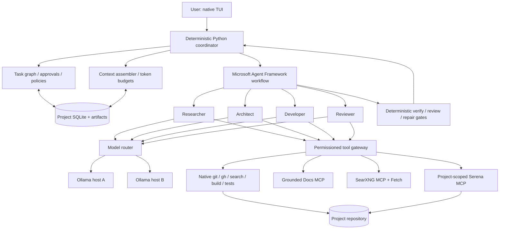

# Local AI Coder — Architecture Design Proposal

**Status:** Design review draft — **not** an implementation specification or TODO checklist  
**Version:** 0.1  
**Date:** 2026-10-19  
**Intended reviewers:** Project owner and Claude  
**Working name:** Local AI Coder (placeholder)

> **Purpose.** Define a practical, local-first autonomous coding system based on Microsoft Agent Framework, small locally hosted LLMs, context-isolated specialist agents, existing open-source MCP tools, and a terminal UI. The document records architectural recommendations, tradeoffs, risks, and unresolved decisions. It deliberately does **not** prescribe the final file-by-file implementation or claim that the proposed integrations have already been tested together.

---

## 1. Executive summary

The aim is to make a relatively small local LLM—initially **Qwen3.5-9B** served by **Ollama**—substantially more useful for real software development than the current single-agent OpenCode experience, especially on long-running, multi-file tasks.

The principal problem is **limited usable context**. Agent instructions, tools, repository content, error logs, and long conversations compete for the same token budget. Simply increasing Ollama's context allocation is useful, but can raise memory usage and does not solve irrelevant-context accumulation or poor task discipline.

The proposed solution is a **context-isolated, evidence-driven coding workflow**:

- One **deterministic Python coordinator** controls the task graph, retries, permissions, tool dispatch, checkpoints, and verification gates.
- Four **logical specialist roles**—**Researcher, Architect, Developer, Reviewer**—use an interchangeable LLM endpoint. The first prototype may combine Researcher and Architect into one role.
- Each agent invocation receives a **fresh, bounded, purpose-specific context**. Agents exchange structured artifacts and references, not entire conversation transcripts.
- **Serena MCP** provides source-code intelligence. **Grounded Docs MCP** indexes/searches technical documentation locally. **SearXNG + its MCP adapter** supplies free web search; **Fetch MCP** retrieves selected pages. Standard local command wrappers provide Git, `gh`, compilers, and tests.
- **SQLite**, source-linked project memory, and Agent Framework checkpoints preserve verified findings and workflow progress across context resets and process restarts.
- The interface is a **native TUI**. There is no required VS Code integration, Ralph Bridge, Docker, commercial API, or proprietary hosted service.
- **Multiple projects can run concurrently as separate native processes** on the same computer. Each can target a different local or remote Ollama server, use a separate Serena instance, and maintain isolated task data.

**The intended result is greater *effective* working memory, not a larger native context window.** Every model call remains constrained by the selected model/server context limit. The system compensates through retrieval, decomposition, bounded tool output, persistence, and controlled handoffs.

### 1.1 Key design principles

1. **Local-first and no required recurring API fees.** All required components must be runnable with open-source software on user-controlled machines. Internet access is permitted for requested documentation, web search, and GitHub tasks; offline mode must remain useful.
2. **Correctness over speed.** Sequential multi-pass reasoning is acceptable when it measurably improves successful task completion.
3. **Context is a managed resource.** Allocate model attention to evidence relevant to the immediate subtask, not accumulated transcript history.
4. **Deterministic verification outranks model confidence.** Tests, compiler diagnostics, file diffs, repository state, and explicit human acceptance are more authoritative than a review agent's opinion.
5. **Reuse existing tools.** Integrate Serena, documentation search, SearXNG, `git`, and `gh` rather than recreating their functionality.
6. **Isolate mutable state.** Projects, workspaces, agent sessions, memory, checkpoints, and tool permissions must not bleed across tasks.
7. **Model independence.** Ollama is the starting provider, not a hardcoded architectural dependency.
8. **Native-process deployment.** Neither Docker nor Podman is necessary for normal operation. Additional sandboxing can be introduced for untrusted code execution.

## 2. Objectives, scope, and exclusions

### 2.1 Primary objectives

- Build a useful autonomous coding assistant for **repository understanding, bug fixes, multi-file refactors, feature development, test creation, debugging, and iterative repair**.
- Operate effectively with **~9B-class models** and modest practical context budgets on 16 GB VRAM GPUs; permit larger or remote models without redesign.
- Support **long-running tasks** that survive context compaction and process restarts.
- Support **multiple independent repositories simultaneously**, potentially using different inference hosts and models.
- Use **open-source, self-hostable MCP services** for code navigation, documentation retrieval, and web research, with **no required paid APIs**.
- Provide a transparent TUI showing current work, tool actions, diffs, verification outcomes, context use, and approval requests.
- Establish measurable evidence of advantage over a strong **OpenCode + Ollama + equivalent context/tools** baseline.

### 2.2 Secondary objectives

- Configurable agent-specific models and tool permissions.
- Optional GitHub Actions workflow dispatch/status inspection using `gh`.
- Optional project-specific tooling for Rust, Python, TypeScript, Android, browser UI, and other ecosystems.
- Optional document/vector retrieval improvements once a simpler FTS baseline is measured.

### 2.3 Explicit non-goals for the initial system

- **No Ralph Bridge** (it solved ChatGPT sandbox/connectivity constraints, not a requirement for a native local coding tool).
- **No VS Code plugin** or IDE integration.
- **No Docker/Podman requirement**, Kubernetes, or distributed agent-control plane.
- **No paid LLM, search, or documentation API requirement**.
- No unconstrained autonomous production deployment or unrestricted shell execution.
- No assumption that more agents always outperform a well-equipped single agent.
- No claim that accepted reasoning, accepted code, or green CI automatically proves hardware or real-world acceptance.
- No general multi-user SaaS or public internet-exposed management UI.

## 3. Logical architecture



**Boundary of responsibility:** Agent Framework provides agent and workflow primitives, MCP integrations, and checkpoint support; **our application** supplies the coding-specific control plane, context assembly, task artifacts, permission enforcement, lease ownership, Git safety, test evaluation, and TUI. Agent Framework alone is not a full coding assistant.

### 3.1 Main runtime components

| Component | Responsibility | Implementation candidate |
|---|---|---|
| TUI | Task entry, progress, approvals, diffs, diagnostics, project management | Python Textual or comparable open-source TUI |
| Coordinator | State machine, dispatch, retries, stop conditions, budgets | Python asyncio + typed domain objects |
| Agent runtime | Agents, execution graph, typed handoffs, checkpoints | Microsoft Agent Framework, version-pinned |
| Model router | Per-project/per-role model configuration and health checks | Ollama native client initially; provider abstraction |
| Context manager | Retrieval, token budgeting, context assembly, compaction | Local Python service |
| MCP manager | Launch/connect, enumerate tools, scope permissions, timeouts | MCP stdio / Streamable HTTP client |
| Tool gateway | Allowlisted actions, command policies, bounded outputs, audit | Native Python tools wrapping `git`, `gh`, build/test tools |
| Task and memory store | Plans, evidence, revisions, provenance, locks, replay records | Project-scoped SQLite + files |
| Documentation retrieval | Indexed public/local docs and versioned references | Grounded Docs MCP; optional local embedding server |
| Web retrieval | Search results and selected-page fetching | Self-hosted SearXNG, MCP adapter, Fetch MCP |
| Source intelligence | Symbols, references, structured edits | Project-scoped Serena MCP / language servers |

## 4. Agents and workflow design

### 4.1 Recommended roles

**Researcher — read-only exploration.** Discover repository topology, relevant symbols, callers, data flow, existing test infrastructure, version constraints, and documentation. Return source-anchored findings and known uncertainties. Prefer Serena and targeted lexical search rather than reading entire files.

**Architect — solution and task design.** Convert a user objective plus researched evidence into a dependency-aware, bounded implementation plan. Identify interfaces, migration consequences, safety risks, and objective acceptance checks. Escalate genuinely ambiguous product decisions. Revisit architecture after repeated failed repairs.

**Developer — controlled mutation.** Implement one bounded subtask per working context, using project-specific editing tools. Write or update tests. Inspect actual diagnostics and produce a patch plus structured change summary. Do not claim success based solely on generated text.

**Reviewer — independent critical review.** Start from requirements, source references, **actual diff**, and verification evidence—not the Developer's narrative. Check correctness, regressions, security, resource handling, edge cases, and scope creep. Return actionable findings with file/line evidence and severity. Reviewer remains read-only.

**Coordinator — not an LLM role.** A deterministic state machine schedules agents, persists state, enforces budgets and policy, invokes checks, tracks retries, and decides which *procedural* action follows. It should not ask a 9B LLM whether an exited-with-error test is a pass.

| Role | May edit project files? | Typical information received | Initial tools |
|---|---|---|---|
| Researcher | No | Objective, repo revision, symbol map, selected docs | Serena read tools, `rg`, docs, search |
| Architect | No | Requirements, compact verified research, constraints | Serena read, docs, plan validator |
| Developer | Yes, scoped | One subtask, relevant symbols, acceptance criteria, bounded test feedback | Serena read/write, file patch, targeted tests |
| Reviewer | No | Original requirements, diff, test results, relevant code | Serena read, diff, static analysis, test reports |
| Coordinator | Via policy-controlled operations | Authoritative task and repository state | Local Git, `gh`, executor, storage, policy engine |

**Recommended rollout:** Start with **three LLM roles** (Research/Architect combined, Developer, Reviewer), then separate Researcher and Architect **only if evaluation supports the additional role**. Four logical roles remain the target design. Do not add a free-form debating council as a baseline feature.

### 4.2 Standard task lifecycle

```text
User request
    -> create task / capture repository HEAD and clean/dirty state
    -> research and collect source-linked evidence
    -> design small dependency-ordered subtasks + acceptance criteria
    -> execute one subtask in a fresh Developer context
    -> run formatting / static checks / relevant tests (deterministically)
    -> if failing: bounded diagnosis and repair; reassess architecture if needed
    -> independent Reviewer context examines diff and evidence
    -> if review findings: targeted repair + re-verification + re-review
    -> final configured verification suite
    -> display diff and approval request (as policy requires)
    -> optional local commit, push, CI dispatch / observation
    -> reconcile observed results and persist task state
    -> report completed, blocked, or partially verified outcome
```

### 4.3 Typed agent handoffs

Agents should pass **references and concise structured artifacts**, not entire transcripts. Example *conceptual* format:

```yaml
task_id: T-0042
repository_revision: 0123456789abcdef
objective: Fix incorrect playback queue transition
relevant_symbols:
  - path: src/audio/queue.rs
    symbol: PlaybackQueue::next
    source_revision: 0123456789abcdef
constraints:
  - Do not change the public queue API
  - Preserve ordering and error behavior
acceptance_checks:
  - cargo test queue_transition
  - cargo clippy --all-targets -- -D warnings
unknowns:
  - Whether a hardware-only race condition is involved
```

The coordinator validates these artifacts with **Pydantic/JSON Schema**; malformed outputs are repaired or escalated. Each fact should carry provenance, validity revision, and confidence/verification state where relevant.

### 4.4 Repair policy

- Prefer deterministic diagnosis: error code, file, line, first relevant stack trace, reproducible test.
- Start with **three bounded repair attempts** for a subtask as a configurable default, not a universal maximum.
- Detect repeated identical failures; avoid endless oscillating edits.
- On persistent failure, ask Architect to reconsider assumptions; stop if there is no evidence-driven next step.
- Independent subtasks may continue when safe; dependent tasks remain blocked.
- Distinguish **test pass**, **review pass**, **CI pass**, and **human/hardware acceptance** as separate states.

## 5. Context management and effective working memory

This is the most important differentiator from a conventional chat-based coding agent.

### 5.1 Isolation rules

- Every specialist has a **separate agent session/context**.
- The default handoff contains **only an approved structured artifact** and referenced evidence.
- Do not use default whole-conversation relay between agents. Agent Framework's `AgentExecutor` default `context_mode="full"` can propagate upstream history; use explicitly curated inputs or `context_mode="custom"` as appropriate.
- Store full raw tool output on disk for diagnostics but feed the model bounded excerpts.
- Prefer **source-backed retrieval** over iterative summary-of-summary compaction.
- Keep the reviewer's working context independent from the Developer's attempt history.

### 5.2 Proposed context assembly sequence

1. Determine current task and agent role.
2. Choose model and verify its **actual** server-allocated context capacity.
3. Reserve separate token budgets for role instructions, tool schemas, retrieved evidence, current interaction, and output/reasoning.
4. Retrieve only relevant symbols, snippets, local documentation, test results, and previously verified constraints.
5. Deduplicate, rank, trim, and attribute each excerpt; preserve fetchable references.
6. Run the agent; record tool calls, revisions, and structured result.
7. Save accepted findings; discard irrelevant conversational scaffolding before the next agent invocation.

**Illustrative planning budgets, not hardware guarantees:** 16–32K for research/review; 32–64K for the Developer; tune per model and endpoint. A large advertised context is not synonymous with reliable long-context reasoning. Never assume a 256K allocation will fit efficiently on 16 GB VRAM.

### 5.3 Project memory tiers

| Memory tier | Contents | Source of truth / retention |
|---|---|---|
| Ephemeral working context | Present subtask, selected code, current errors | Per agent invocation |
| Task memory | Plan, dependency graph, diffs, checks, pending approvals | SQLite + artifacts for task lifetime |
| Project memory | Architecture decisions, symbol maps, conventions, documented contracts | Persistent but revision-aware; refreshed on changes |
| External documentation index | Retrieved upstream framework/library docs | Grounded Docs; source URL/version/timestamp |
| Raw evidence archive | Test logs, tool outputs, command records, artifacts | On-disk append-only or immutable blobs |

Start with **SQLite + FTS5 + Serena**; avoid introducing a new vector database until retrieval benchmarks justify it. Grounded Docs may use its own index and optional embeddings for external documentation. A separate project-memory RAG server is **optional**, not a prerequisite.

### 5.4 Freshness and provenance

All source-derived findings should record the relevant Git revision, file/symbol reference, and retrieval time. Before using an old finding to edit code, validate that the referenced content has not changed. Documentation excerpts should carry URL, version when known, and retrieval date. Search-engine snippets are leads, **not authoritative source evidence**.

## 6. Tools and MCP architecture

### 6.1 Recommended initial tool stack

| System | Role | Native/self-hosted? | Requirement |
|---|---|---|---|
| **Serena MCP** | Symbol-level navigation and editing | Locally executable; language-server-backed | **Core** |
| **Grounded Docs MCP** (`arabold/docs-mcp-server`) | Index/search technical docs, local files, upstream references | Self-hostable; optional local Ollama embeddings | **Core** |
| **SearXNG** + **mcp-searxng** | Web searches for errors, examples, upstream issues | Self-hostable; outbound queries to public engines | Recommended |
| **Fetch MCP** | Retrieve selected web pages as bounded Markdown | Local MCP process; outbound page access | Recommended |
| `git`, `gh` | Local revisions and GitHub operations | Native CLI | Core / optional remote actions |
| `rg`, `fd` | Fast lexical source search | Native CLI | Core |
| Compiler/test toolchains | Evidence-backed verification | Native CLI | Core |
| Local SQLite + FTS5 | State and memory search | Embedded, no server requirement | Core |

**Not required:** Context7 hosted backend, Exa hosted search, DeepWiki hosted backend, Brave paid API, remote Microsoft Learn MCP, paid model API, GitHub MCP, Ralph Bridge, or IDE-specific MCP.

The **MCP manager** should support stdio and Streamable HTTP, package/version pinning, enable/disable, health status, tool discovery, per-role exposure, timeouts, output limits, and restart of crashed local servers. Dynamic availability of tools must not bypass policy enforcement.

### 6.2 Tool access should be least-privilege

| Capability | Researcher | Architect | Developer | Reviewer |
|---|:---:|:---:|:---:|:---:|
| Serena read/navigation | Yes | Yes | Yes | Yes |
| Serena edit/refactor | No | No | Scoped | No |
| Grounded Docs lookup | Yes | Yes | On demand | On demand |
| Web search/fetch | On demand | On demand | Limited | Limited |
| Local Git status/diff | Read | Read | Read | Read |
| Write workspace files | No | No | Scoped | No |
| Run configured test commands | No | No | Through coordinator | Through coordinator |
| Push, CI dispatch, destructive Git actions | No | No | No | No |

The **coordinator's authorization layer** owns sensitive writes and remote actions. An instruction such as “Reviewer is read-only” must be enforced by the tool gateway or OS permissions, not merely by prompting the model.

### 6.3 Serena project-scoping

Launch **one Serena MCP instance per active project process** using a project-specific root and configuration. Serena's language-server-backed indexes/cache remain associated with that project. Serialize or coordinate access to mutable source when multiple agents use the same instance. Never allow an untrusted agent to silently switch Serena's active project root.

Use MCP stdio process ownership where possible; supervise process health, shut it down cleanly, and restart after crashes. Pin a Serena version and validate its current tool inventory—Serena v2 has meaningful interface and licensing changes.

### 6.4 Grounded Docs indexing

- Index programming documentation, relevant project docs, and chosen external framework/library references.
- Prefer version-specific docs when available; record freshness/URLs.
- Start with keyword/full-text retrieval, then enable **local embeddings** only if needed.
- If embeddings use Ollama, **do not accidentally overload the coding inference GPU**. Prefer a small CPU-hosted embedding model or an independently scheduled server.
- For multiple projects, either use isolated storage/indexes or prove the shared service supports hard namespace boundaries and per-project permissions. Do not assume naming a collection alone enforces confidentiality.
- Disable optional telemetry and restrict outbound crawl/file access to authorized roots and domains.

### 6.5 SearXNG and Fetch boundaries

SearXNG requires its own service plus an MCP adapter; the adapter is not the search engine. Configure JSON responses and native Linux deployment. External search providers may rate-limit or block automated requests; the system must degrade gracefully.

Fetch and crawler tools should enforce destination restrictions and protect against **SSRF** (including internal addresses and redirects), large responses, malicious pages, and prompt injection. Treat remote content as untrusted data. Never transmit proprietary source excerpts to web searches by default.

### 6.6 Native commands versus MCP

Use **native policy-wrapped Python subprocesses** for `git`, `gh`, `cargo`, `uv`, `pytest`, `gradle`, and similar developer commands. There is no compelling reason to create or install an MCP server for every command. Model-facing tools should be narrow and typed, for example `run_named_test(test_id)` or `get_git_diff(paths)`, rather than unrestricted arbitrary shell access.

## 7. Model and inference topology

### 7.1 Initial assumptions

- **Initial baseline:** Qwen3.5-9B, a GGUF/Ollama quantization that fits the endpoint's GPU at a practical context.
- **Alternatives:** Qwen3.5-27B (including heavily quantized models), other open-weight coding models, or stronger nondefault providers later.
- **Execution policy:** usually one inference request at a time **per Ollama endpoint**, unless that server's resource profile permits more.
- **Role model selection:** optional model profile per agent, resolved through the project configuration.
- **Reasoning strategy:** structured plan/implement/verify/review with actual tool feedback; don't rely on generic “think harder” prompting alone.

Qwen3.5-9B and 27B are **candidate models, not guaranteed best choices**. Context allocation, GPU/offload behavior, and tool-call correctness must be measured. A bigger quantized model may underperform a smaller model with better context/tool access.

### 7.2 Project-specific configuration (illustrative, not a finalized schema)

```yaml
project:
  name: project-a
  repository: /home/user/projects/project-a

model_profiles:
  coding:
    provider: ollama
    host: http://127.0.0.1:11435  # e.g., SSH tunnel to remote Ollama A
    model: qwen3.5:9b
    requested_context: 65536
    max_parallel_requests: 1
  review:
    provider: ollama
    host: http://127.0.0.1:11436  # optional remote Ollama B
    model: qwen3.5:27b
    requested_context: 32768
    max_parallel_requests: 1

agents:
  researcher: {model_profile: coding}
  architect:  {model_profile: coding}
  developer:  {model_profile: coding}
  reviewer:   {model_profile: review}

mcp:
  serena: {enabled: true, project_scoped: true}
  grounded_docs: {enabled: true}
  searxng: {enabled: true}
  fetch: {enabled: true}

git_policy:
  auto_commit: false
  auto_push: false
  require_approval_for_remote_mutation: true

execution:
  max_active_tasks_per_repository: 1
  max_repair_attempts_before_replan: 3
  offline_mode: false
```

The final config should validate reachability, model availability, actual `num_ctx` allocation, credentials, workspace root, and project ownership before beginning. **Setting a `requested_context` field in the AI coder cannot by itself increase an Ollama model's actual context.** The inference server must honor the allocation.

### 7.3 Remote Ollama security

Remote Ollama APIs are generally not authenticated by default. Use loopback-bound services with **SSH tunnels**, trusted private VPNs, or a suitably authenticated reverse proxy. Avoid publishing the inference port directly to the internet. Project config stores endpoint references, never credentials embedded in agent-visible messages.

## 8. Multi-project concurrency — no containers required

**Project A and Project B may run concurrently on one Ubuntu computer as separate native TUI processes, targeting different Ollama hosts.** Separate containers are unnecessary for this arrangement.

```text
                       Ubuntu workstation
                     /                     \
         ai-coder (Project A)         ai-coder (Project B)
           Serena process A            Serena process B
           SQLite database A           SQLite database B
           Repo/workspace A            Repo/workspace B
                |                            |
          Ollama server A              Ollama server B
           (remote GPU)                 (remote GPU)
```

### 8.1 Per-project isolation contract

Each active project has its own:

- Stable project ID (not merely directory basename), canonical root, and repository identity.
- Coordinator process, agent sessions, task queue, current execution lease, and checkpoints.
- Serena MCP process and language-server state.
- SQLite database, project-specific memory, logs, and artifacts.
- Model routing configuration and budgets.
- Filesystem allowlist, policy settings, and authorization events.

Infrastructure that may be shared: one installed Python environment/application, `git`, `gh` installation, trusted SearXNG service, and read-only public documentation indexes. A shared Ollama server is also possible, but must be subject to **endpoint-level queueing/backpressure**.

### 8.2 Workspace ownership and collisions

- At most **one mutating session per repository/worktree** by default. Independent repositories may run simultaneously.
- Use an OS file lock plus persisted lease/heartbeat metadata for crash recovery; a lock is not a substitute for source revision validation.
- Detect external edits and conflicting processes before applying patches.
- Do not blindly reapply a patch after an ambiguous timeout; re-read the file/Git state and reconcile first.
- Never allow Project A's MCP clients, search results, or checkpoint paths to resolve silently into Project B's root.

### 8.3 State layout (illustrative)

```text
~/.config/local-ai-coder/
    config.yaml                 # global defaults, named MCP servers, model profiles

repo-a/.ai-coder/config.yaml    # nonsecret per-repo overrides (optional)
repo-b/.ai-coder/config.yaml

~/.local/share/local-ai-coder/
    projects/<stable-id-a>/
        tasks.sqlite
        checkpoints/
        evidence/
        logs/
    projects/<stable-id-b>/
        tasks.sqlite
        checkpoints/
        evidence/
        logs/
```

Secret material should be stored outside repositories and excluded from logs. Shared documentation indexes should be under a separately permissioned directory.

## 9. Git, GitHub, and CI

### 9.1 Local Git

Use native `git` for revision inspection, diff calculation, status, commits, and worktree coordination. Capture the initial HEAD, index, and dirty state before each task. Treat user changes as first-class: do not reset, stage, overwrite, or commit pre-existing changes silently.

**Suggested default:** implement changes in the user's configured workspace with safe patch preconditions; never assume permission to create branches, commit, or push. Branching versus direct-to-master is a **per-project policy**. This new system should not inherit unrelated Ralph Bridge restrictions by accident.

### 9.2 GitHub Actions via `gh`

Use `gh` for authenticated remote operations, including:

```bash
gh auth status
gh run list --branch master --limit 10
gh run view <run-id> --json status,conclusion,headSha,workflowName,htmlURL
gh run view <run-id> --log-failed
gh workflow run <workflow> --ref <branch-or-tag>  # only if dispatch is enabled
gh run watch <run-id> --exit-status
```

The coordinator must record both requested and observed commit SHAs and correlate results with the exact source revision. CI passing on an unrelated SHA must not count as verification for the current patch. Never auto-dispatch runs just to burn CI capacity; obey rate, quota, and project policy.

### 9.3 Approval model

Proposed defaults:

- Read source, search docs, run allowlisted non-destructive diagnostics: preauthorized.
- Edit files within a configured writable workspace: configurable approval; show diff.
- Commit local changes: explicit setting or approval.
- Push, open/merge PR, dispatch remote CI, manage issues: explicit policy plus audit record.
- Delete/reset history, remove files outside a task's scope, change secrets, deploy to production: require specific confirmation; some actions may be disallowed entirely.

“Autonomous” means the system can complete **authorized** tasks, not that it may ignore established approval boundaries.

## 10. Persistence, transactions, and recovery

### 10.1 Durable project records

Conceptual entities: `projects`, `runs`, `tasks`, `task_dependencies`, `agent_invocations`, `artifact_refs`, `findings`, `tool_events`, `verification_results`, `approvals`, `leases`, `model_profiles`, `mcp_connections`, and `checkpoint_refs`.

Use SQLite transactions for task/lease updates and append-only audit events. Large logs, raw tool outputs, patches, and snapshots belong in files referenced by content hash and bounded metadata, not giant SQLite rows.

### 10.2 Checkpoint/restart protocol

Agent Framework supports workflow checkpoint storage, including local file-backed storage. This does **not** make filesystem edits, Git commits, and tool effects transactional with framework state.

Before an external side effect: journal **intent + expected revision**. Afterward: record **observed outcome + new revision**. On restart, reconcile current files/HEAD/tool results against the journal before retrying. Only resume a workflow step once its side effects have a known state.

Checkpoint safely at meaningful boundaries: research complete, plan accepted, patch applied, tests completed, review completed, approval pending, remote CI requested, etc. Checkpoints may contain source snippets or secrets from tool interactions; secure and redact stored data accordingly.

### 10.3 Stop and outcome states

The final report should clearly distinguish:

- **Complete and verified** under defined local criteria.
- **Locally verified; CI pending/not run**.
- **Software implemented; hardware/manual acceptance pending**.
- **Blocked by authorization, credentials, environment, ambiguous requirements, or unavailable resources**.
- **Failed after bounded repair/replan**.
- **Interrupted and resumable**.

## 11. Security and trust model

This system can edit source code and run project-defined commands, so its threat model is broader than an ordinary chatbot.

### 11.1 Primary risks and mitigations

| Risk | Proposed mitigation |
|---|---|
| Tool or repository content instructs the agent to override user policy | Treat all retrieved text as data; separate system policy from untrusted content; enforce rules in coordinator |
| Shell/tool execution harms host | Allowlisted command APIs, cwd restrictions, timeouts, resource limits, confirmation for dangerous operations |
| Access to unrelated repos/home files | Canonical-root allowlists; reject path traversal and unauthorized symlinks; optional OS sandbox |
| Remote web content leaks private source | Prohibit source snippets in external search by default; allow reviewed exceptions only |
| MCP server exposes dangerous or unexpected tools | Pinned versions, tool inventory review, per-role allowlist, bounded results, process supervision |
| Web search/fetch SSRF or malicious links | URL/redirect validation, reject private/metadata ranges, fetch limits |
| Git history or user changes overwritten | Pre-write revision checks, diff review, clean/dirty-state capture, no unconditional resets |
| Concurrent writers corrupt the same project | Single-writer lease, revision checks, reconciliation |
| Remote Ollama exposed without authentication | SSH tunnel / private network / auth proxy; no public raw port |
| Secrets appear in logs, model context, or checkpoint | Minimal environment inheritance, redaction, secure file modes, retention controls |
| Runaway recursion, tokens, CI usage | Iteration limits, retries, wall-clock budgets, CI quotas, explicit stop states |

Separate `uv` environments and native processes **are not security sandboxes**. Since containers are not desired, an optional Linux sandbox such as `bubblewrap` could be investigated for untrusted tool execution, subject to kernel/host compatibility. This is independent of the no-container requirement for ordinary multi-project execution.

### 11.2 Offline and network modes

- **Offline:** local Ollama, Serena, indexed docs/memory, local Git and tests; no SearXNG/external fetch/GitHub API.
- **Network-enabled:** selected outbound search/doc updates, user-authorized `gh` calls, remote Ollama connections.
- **Privacy-sensitive:** local inference plus remote model hosts trusted by the user; no cloud documentation/query transmissions with project code.

## 12. TUI and user experience

The TUI is the sole required interactive interface. A candidate toolkit is **Textual** (verify selected version/license before implementation).

### 12.1 Views

| View | Key functions |
|---|---|
| Project selector | Open/create project session, see active projects and inference endpoints |
| Main task view | Prompt, subtasks/dependencies, active agent, phase, blockers, approvals |
| Agent inspection | Role, model, context usage, selected tools, brief current action |
| Diff and review | File list, side-by-side or unified patch, review findings, approval |
| Verification | Named tests, compiler/lint failures, revision tested, CI status |
| MCP manager | Add/test/enable/disable servers, enumerate tools, configure role permissions |
| Model manager | Endpoint health, model choices, `ollama ps`-equivalent info where available, context allocation |
| History and recovery | Previous runs, checkpoints, resumes, failure evidence, export |

### 12.2 Control semantics

- **Pause:** stop scheduling new agent/tool steps; finish or cancel the active step safely.
- **Resume:** reconcile repository and persisted state before continuing.
- **Stop:** terminate task execution and preserve recoverable evidence.
- **Approve/reject:** explicitly authorize a proposed edit/commit/remote action.
- **Inspect:** source-linked reasoning summary, evidence, diff, logs, and tool outcomes.
- **Switch project:** connect to its independent process/state; do not repurpose another project's Serena context.

A future **read-only global status view** may enumerate other active project processes, but a central dashboard/control daemon is not required for the first release.

## 13. Reliability, evaluation, and benchmark plan

The central hypothesis—**isolated agents plus good retrieval outperform a strong single agent on the same hardware**—must be tested rather than assumed.

### 13.1 Comparative configurations

| Configuration | Description |
|---|---|
| A | OpenCode + Qwen3.5-9B + reasonably tuned context, identical workspace and comparable tools |
| B | Single Agent Framework coding agent + Serena + docs/search + persistence |
| C | Three-role workflow (Research/Architect, Developer, Reviewer), isolated contexts |
| D | Four-role workflow (Researcher, Architect, Developer, Reviewer), isolated contexts |
| E (optional) | Larger/alternative model or per-role model mix on suitable endpoints |

Keep test tasks, tool access, starting repository revisions, and budgets comparable. Include an **ablative test** without Grounded Docs or Serena to measure what actually helps.

### 13.2 Evaluation tasks

Use a curated set of reproducible repositories/tasks: small bug fix, multi-file refactor, unfamiliar code exploration, test failure debugging, new feature with interface constraints, long-document requirements, and a task involving interrupted/resumed execution. Include Rust, Python, and at least one UI/mobile ecosystem if relevant.

**Avoid evaluating only tasks the system was trained or tuned against.** Use hidden or independent acceptance tests where possible.

### 13.3 Metrics

- Verified task success and regression rate.
- Test/lint/build results at the *correct source revision*.
- Human interventions and unnecessary modifications.
- Tool-call validity and recoverable tool errors.
- Context size requested versus actually allocated, peak token usage, truncations.
- Inference time, elapsed task duration, retries, GPU/offload behavior.
- Source retrieval relevance/provenance and stale-memory incidents.
- Crash/restart recovery success and concurrent-session collision incidents.
- Cost proxies: total model tokens/compute time and unnecessary CI runs.

Define quantitative go/no-go thresholds in the **future spec**, after establishing baseline measurements; do not invent expected performance percentages now.

## 14. Delivery strategy (design-level, not TODO)

**Stage 0 — Baseline and technical validation.** Confirm Agent Framework ↔ Ollama function calling, model context allocation, minimal Serena navigation, Grounded Docs retrieval, and native project tool execution. Capture OpenCode baseline on representative tasks.

**Stage 1 — Single-agent vertical slice.** TUI + one coding agent + Serena + source revision guard + small patch + deterministic tests + diff/approval. Get one real task end to end.

**Stage 2 — Isolated multi-agent workflow.** Add researcher/planner, reviewer, typed handoffs, bounded prompts, and repair/replan gates. Compare with Stage 1 before increasing agent count.

**Stage 3 — Persistence and durable autonomy.** SQLite records, checkpoint recovery, revision-aware project memory, crash reconciliation, project lease, detailed evidence logs.

**Stage 4 — Multi-project and multiple inference hosts.** Independent TUI processes, per-project Serena/memory, role/model routing, endpoint queueing, simultaneous workload tests.

**Stage 5 — Optional advanced integrations.** SearXNG search, Grounded Docs indexing lifecycle, GitHub Actions through `gh`, project-specific Android/browser tooling, offline/privacy modes, optional local sandboxing.

Order is adjustable: at least one documentation retrieval path may be included earlier for proving realistic repository work.

## 15. Architecture tradeoffs and rejected defaults

| Decision | Recommended baseline | Why | Cost/tradeoff |
|---|---|---|---|
| Coordinator | Deterministic Python | Reliable control flow and reproducible retries | Must implement task-specific logic |
| Agent topology | 3 initially, 4 target | Limited handoff overhead; independent review | Extra inference time; same-model error correlation |
| Context sharing | Curated artifact handoffs | Prevents unbounded transcript growth | Can omit important context if retrieval is poor |
| Code navigation | Serena + `rg` | Efficient symbol-level access | Language server/index setup, version changes |
| Docs search | Grounded Docs | Self-hosted and indexable | Requires crawling, updates, storage management |
| Web search | SearXNG + adapter | No paid search API | Search engine rate limits and maintenance |
| Repository GitHub | Native `git`/`gh` | Simple, appropriate for local host | Need safe command wrappers, auth, CI reconciliation |
| UI | Native TUI | Low overhead, terminal-friendly | Less discoverable than an IDE/web UI |
| Project isolation | Separate OS processes/state | Simple, no Docker needed | Not a hardened security boundary |
| State | SQLite + checkpoints | Lightweight, durable, inspectable | Needs careful side-effect reconciliation |
| Model routing | Configurable Ollama clients | Multi-host support and model experiments | Endpoint health/queue management |

### 15.1 Why not a group chat?

Passing entire conversational histories between agents recreates the context-window pressure we are trying to fix. A structured, directed workflow with selected evidence is a better starting point for smaller models.

### 15.2 Why not assume a 27B model solves everything?

With 16 GB VRAM, a heavily quantized 27B model leaves less memory for context and may offload to CPU. A smaller model with strong retrieval and verification might do better on some tasks. Compare empirically.

### 15.3 Why not use Docker for Project A and B?

Different Ollama endpoints and per-project state do not require container boundaries. Docker may later be useful for untrusted dependency isolation, but that is a separate security/packaging question.

## 16. Open design questions for Claude's review

These are **intentional decisions to resolve before writing the authoritative spec and TODO**:

1. **Agent count:** Is the four-role target justified, or is three roles (Research/Plan, Developer, Reviewer) sufficient? What objective signal should trigger role splitting?
2. **Coordinator implementation:** Should the workflow be built using Agent Framework graph/executors or primarily as a Python async functional workflow with Agent Framework agent calls?
3. **Context budgets:** What prompt composition, context-reserve, compaction, and continuation strategy performs best with Qwen3.5-9B and available GPU memory?
4. **Tool robustness:** How will tool-call schemas, output truncation, timeouts, and structured-output validation be tested against actual Qwen/Ollama combinations?
5. **Memory:** Which findings should survive indefinitely, and what invalidation/provenance scheme prevents stale architecture notes from misleading agents?
6. **Project leases:** What lock/journal/reconciliation model handles concurrent TUI sessions, external human edits, and crashes safely?
7. **Workspace policy:** Should the application edit the user's working tree by default, or should an isolated `git worktree` be the optional/default safe mode?
8. **Git policy:** What is the default approval boundary for file edits, local commits, pushes, CI dispatch, and PR operations?
9. **Documentation retrieval:** Is Grounded Docs sufficient alone, or does adding a second local RAG index duplicate complexity without improving results?
10. **SearXNG operation:** Is running/maintaining a metasearch service worthwhile for the first release, or should it remain an optional plugin until measured?
11. **MCP scoping:** Can a single Serena process safely serve sequential agents with enforced tool permissions, or should some workflows use distinct read/write clients?
12. **Security model:** Is policy-wrapped native execution enough for trusted repositories, and when is OS sandboxing mandatory?
13. **State storage:** How much belongs in Agent Framework checkpoints versus our own SQLite/event journal?
14. **Remote model profiles:** Should endpoint-level GPU concurrency coordination be a local file lock, local daemon, or a lightweight service on inference hosts?
15. **Licensing/distribution:** Does planned packaging of a separate-process Serena integration create any obligations beyond distributing Serena notices and complying with its GPL? Seek legal review before shipping a combined product.
16. **Evaluation:** What representative benchmark tasks and objective thresholds would justify increased agents, larger contexts, or a quantized 27B model?
17. **Unattended operation:** What human escalation rules and task budgets are appropriate for hours-long execution without allowing unsafe runaway changes?
18. **Product scope:** Should multi-project status aggregation be included in the first release, or is one process per repository sufficient initially?

## 17. Current design decisions vs. proposals

**User-established preferences (treat as fixed unless reconsidered):** native **TUI**, local-first free/open-source stack, no paid API requirement, no Ralph Bridge, no VS Code integration, no requirement for Docker, Git + `gh` for repo/CI operations, Serena integration, meaningful documentation/search MCP support, multiple project processes with configurable local/remote Ollama servers, willingness to trade time for improved correctness.

**Recommended but open to challenge:** Microsoft Agent Framework as orchestration backbone; four logical roles/three at first; deterministic coordinator; Grounded Docs; SearXNG + Fetch; SQLite + FTS5; per-project Serena process; native tool gateway; separate task-scoped contexts; current approval defaults and stage order.

**Not yet decided or validated:** exact Python/Agent Framework package versions, deployment scripts, specific GGUF and effective context, TUI framework, final config schema, MCP tool APIs/version pins, default Git worktree policy, exact sandboxing approach, benchmark targets, packaging/distribution licensing arrangements.

---

## 18. Source references and verification notes

These references ground specific **capability claims**; they are not proof that the complete proposed system has been integrated or benchmarked.

1. **Microsoft Agent Framework — Ollama provider:** native and OpenAI-compatible options, local function tools and MCP integrations.  
   <https://learn.microsoft.com/en-us/agent-framework/agents/providers/ollama>
2. **Microsoft Agent Framework — Agent Executor:** default upstream `context_mode="full"`, available `last_agent`/`custom` modes, independent agent sessions.  
   <https://learn.microsoft.com/en-us/agent-framework/concepts/workflows/advanced/agent-executor>
3. **Microsoft Agent Framework — checkpoints:** resumable workflows and file-backed checkpoint storage.  
   <https://learn.microsoft.com/en-us/agent-framework/workflows/checkpoints>
4. **Microsoft Agent Framework — MCP:** local stdio and HTTP MCP tool clients, restrictions for third-party tools.  
   <https://learn.microsoft.com/en-us/agent-framework/agents/tools/local-mcp-tools>
5. **Serena:** semantic navigation and editing; version-specific documentation.  
   <https://github.com/oraios/serena>
6. **Serena licensing:** v2 Serena application is GPL-3.0-or-later; SolidLSP is MIT; older Serena releases had different licensing.  
   <https://github.com/oraios/serena/blob/main/docs/01-about/060_license.md>
7. **Grounded Docs MCP:** self-hostable technical documentation index and MCP integration; MIT.  
   <https://github.com/arabold/docs-mcp-server>
8. **Grounded Docs + Ollama embeddings:** supported OpenAI-compatible local embedding configuration.  
   <https://github.com/arabold/docs-mcp-server/blob/main/docs/guides/embedding-models.md>
9. **Grounded Docs config/security:** separate `storePath`, telemetry setting, network/file-access controls.  
   <https://github.com/arabold/docs-mcp-server/blob/main/docs/setup/configuration.md>
10. **SearXNG:** open-source self-hostable metasearch engine (AGPL-3.0).  
    <https://github.com/searxng/searxng>
11. **SearXNG MCP adapter:** requires independently running SearXNG instance with JSON search enabled.  
    <https://github.com/ihor-sokoliuk/mcp-searxng>
12. **Fetch MCP:** self-hosted page retrieval, `uvx` launch, outbound/SSRF safety guidance.  
    <https://github.com/modelcontextprotocol/servers/tree/main/src/fetch>
13. **Ollama context controls:** default context and server/API configuration vary by setup; inspect actual allocation.  
    <https://docs.ollama.com/context-length> and <https://docs.ollama.com/faq>
14. **GitHub CLI:** local CLI commands for workflow dispatch and run inspection.  
    <https://cli.github.com/manual/gh_workflow_run> and <https://cli.github.com/manual/gh_run_view>
15. **Microsoft Agent Framework source/examples:** Python agent/workflow/Ollama examples, pin compatible versions rather than copying unverified snippets.  
    <https://github.com/microsoft/agent-framework>

**Verification warning:** API names, installation requirements, Serena tool inventories, and licensing can evolve; verify and pin versions in the subsequent specification. A source license displayed on a repository landing page can be stale during a licensing transition—use component-level documentation and the target release's actual license files.

---

## 19. Suggested review instruction for Claude

> Review this architecture critically as a senior software architect experienced with Microsoft Agent Framework, MCP, local LLM coding agents, Ollama, Linux process isolation, and durable workflows. Identify incorrect assumptions, missing failure modes, unnecessary complexity, unsafe tool permissions, weak context/memory strategies, and scalability concerns. Distinguish **blocking design defects**, **important improvements**, and **optional enhancements**. Pay particular attention to whether isolated multi-agent workflows are more effective than a single-agent baseline for 9B models, per-project concurrency, checkpoint reconciliation with filesystem/Git side effects, Serena/Docs/SearXNG integration, and open-source licensing. Recommend concrete architectural changes, but **do not yet produce an implementation spec or TODO**. Cite authoritative references where implementation-specific claims depend on current APIs.

*End of design review draft.*
